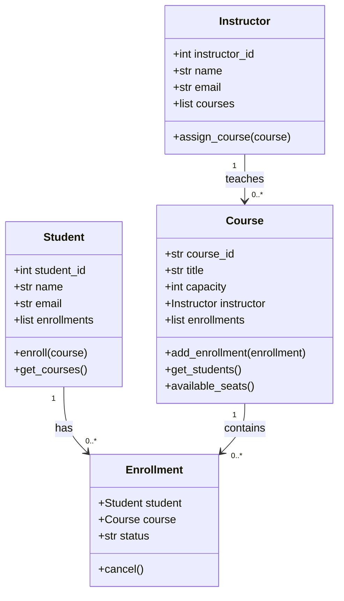

# Student Management System

A small Python object-oriented programming project based on a self-designed UML class diagram.

## Features
- Create students, instructors, and courses.
- Assign courses to instructors.
- Enroll students in courses.
- Prevent duplicate enrollment.
- Enforce course capacity.
- Cancel an enrollment.
- Check available seats.

## UML Class Diagram



## Project structure

```text
student_management_system/
├── student_management/
│   ├── __init__.py
│   └── models.py
├── tests/
│   └── test_models.py
├── main.py
├── README.md
└── requirements.txt
```

## Requirements
- Python 3.10 or newer
- No external packages required

## Run the project

From the project folder:

```bash
python main.py
```

## Run tests

```bash
python -m unittest discover -s tests -v
```

## Student implementation class — testing assignment

See [TEST_CASES.md](TEST_CASES.md) for five documented test cases and [TEST_RESULTS.txt](TEST_RESULTS.txt) for execution results. The new tests are in `tests/test_student.py`.

Run the student-specific tests:

```bash
python -m unittest discover -s tests -p test_student.py -v
```
